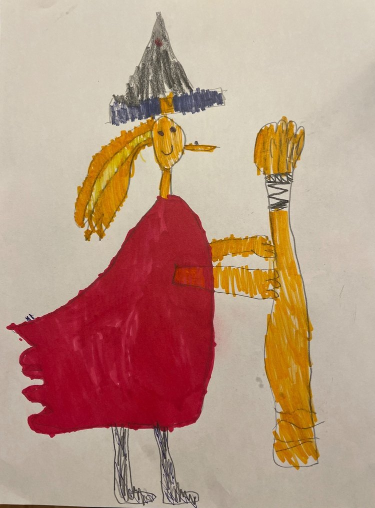
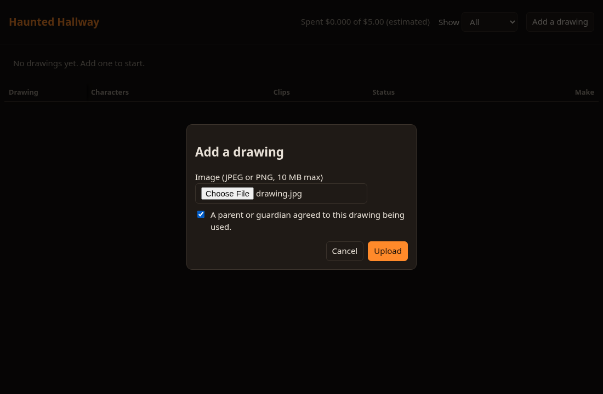
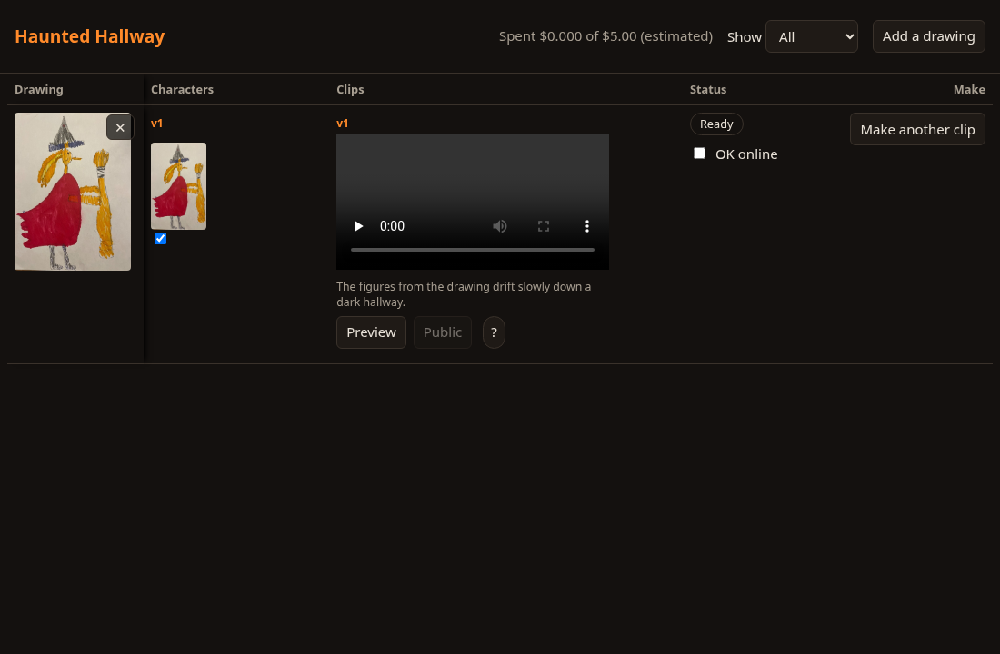

> This is a simplified, self-hostable version of the system I ran on Halloween night. The original used a cloud-hosted pipeline with a more detailed approval console, monitoring and a finer cost ledger.

# haunted-hallway

Kids draw monsters. A small server turns each drawing into a short ghost clip. A projector
plays the approved clips in a loop in your hallway.

**Status: work in progress.** What works today, with a free fake provider:
drawing in, characters out, a fake clip, approve it in a one-table console, publish it,
a read-only loop feed, and a Raspberry Pi player that pulls that loop. The real Gemini
provider is written from Google's current documentation and tested against a local fake
server that counts requests. **It has not been run against the real service yet, and no
real cost has been measured.** The Pi scripts have not run on a real Pi yet.

## What it looks like

Images from the original installation (Oct 31), not from a run of this release; real clip not proven in this release.




The two screenshots below are of this version running locally with the free fake provider.




## Requirements

- Python 3.11 or newer.
- **ffmpeg. It is required.** The server makes and normalises every clip with it and
  **refuses to start with a clear error if it is missing**. Install it before anything else:


```sh
sudo apt install ffmpeg        # Debian, Ubuntu, Raspberry Pi OS
brew install ffmpeg            # macOS
ffmpeg -version                # must print a version
```

If ffmpeg is installed somewhere else, set `FFMPEG_BIN` in `.env`.

## Quick start (about 10 minutes, free, fake clips)

```sh
python3 -m venv .venv && . .venv/bin/activate
pip install -e .
cp .env.example .env
python -m hallway.passwd       # asks for a password, prints ADMIN_PASSWORD_HASH=...
```

Paste the printed `ADMIN_PASSWORD_HASH=...` line into `.env` (do not put it inside double
quotes in a shell, it contains `$`). Pick a random `LOOP_TOKEN` of 16+ characters for the
player. Then:

```sh
python -m hallway
```

Open http://127.0.0.1:8080, sign in, press **Add a drawing**, tick the consent box, then
**Make clip**. Before it starts, a box shows the prompt (you can edit it) and what the clip
is estimated to cost. With the default `PROVIDER=mock` the clip is fake, costs nothing, and
does not use up the spend cap.

## The console

One table, one row per drawing. The drawing stays on the left while characters and clips
scroll. Each time you make a clip you get a new version (v1, v2, ...) of the characters and
of the clip. Every clip version has its own **Preview** and **Public** buttons; pressing the
lit one withdraws it. A drawing shows one clip at a time, so publishing v2 replaces v1.
A coloured pill shows the status and the filter at the top narrows the rows.
**Public** needs the "OK online" box for that drawing. The server refuses a public showing
without that box, even if you call the API directly. The X deletes a drawing and its files
after a confirmation. On a phone each drawing is a card and every button is reachable.
Only one clip can be in progress per drawing: a second request is refused with 409.

## Using the real provider (Gemini)
Tried three times with the default text model; real clip not proven in this release.

The fake provider is the default. To make real clips you need a Google AI Studio key for the
paid tier of the Gemini API (the video model has no free tier).

```sh
pip install -e '.[gemini]'
export GEMINI_API_KEY=...          # from your shell or a secrets manager, not from a file you commit
PROVIDER=gemini SPEND_CAP_USD=1 python -m hallway
```

Start with a low cap. Each clip makes four paid calls with the defaults: one to look at the
drawing, one image per figure (two by default) and one video. Models, from Google's
documentation on 2026-11-05: `gemini-3.8-flash` (look), `gemini-nano-banana-2.1` (characters),
`gemini-omni-1.2-flash` (video, 9:16, 720p, 8 seconds). You can change them in `.env`, but
then the estimates may no longer fit them. Each can also be set in the process environment, which
wins over `.env`. If the text model keeps timing out or answering 503, a documented fallback is
`GEMINI_TEXT_MODEL=gemini-3.5-flash`; the default stays `gemini-3.8-flash`.

**Cost.** Before each paid call the program reserves an *estimate*. The estimates are rough
placeholders, not Google's prices. Check Google's current pricing for the models you use and set
`ESTIMATE_TEXT_USD`, `ESTIMATE_IMAGE_USD` and `ESTIMATE_VIDEO_SECOND_USD` in `.env` to match.
Your Google bill, not this program, is the only authority on what a clip cost. Make your first
clip under a low cap and compare the two.

Safety rules the provider follows: exactly one request per paid call (the Google package alone
would silently retry up to five times), no automatic retry unless you set `GEMINI_RETRIES`, a
request the service refuses outright (a 503, a 4xx) is released because no work was done, any other
failed call (500, timeout) stays booked because it may have been billed, the key is never printed, and the
service address is fixed in code.

**What leaves your machine:** the drawing, the cropped characters and your prompt are sent to
Google. Read Google's terms and its rules about images of children for your region before you
use real drawings.

## Spend cap

A cost is reserved before every paid call and the call is refused if it would pass the cap.
Defaults: 5 USD in total and 2 USD per day, active from the first run. The free fake
provider reserves nothing, so it never uses up the cap; set `MOCK_PRICES=1` if you want to
rehearse the cap with the fake provider using the estimated real prices. A cap that is missing,
zero, negative, not a number or absurdly large falls back to the default. It never means
"unlimited". The console can show the cap but cannot raise it: edit `.env` and restart.

What the cap is, and is not:

- **It limits estimates, not your invoice.** Each call books the estimate you configured (see
  Cost above). Real billing can differ, can arrive later, and can include a call that timed out.
  The ledger keeps the estimates only; it does not compute what Google charged. Set a budget alert
  in your Google account too, and use a key that is used for nothing else.
- **The cap is counted call by call, not clip by clip.** A clip is several calls (one to look, one per
  figure, one video). If the cap cannot pay for a later call, usually the video, the earlier
  calls are already spent and the clip is refused at that point. The refusal is safe, but those
  calls are not refunded. Choose a cap that covers a whole clip at your estimates, and raise it in
  `.env` before trying another.
- It is a lifetime total plus a per-day total, kept in the local database. Deleting the whole
  data folder starts a new ledger at zero: the cap protects against mistakes, not against the
  person who runs the server. Deleting only the database file is refused at start-up.

## Network and TLS

The console and the Pi talk plain HTTP. The sign-in cookie is `HttpOnly` and `SameSite=Strict`
but has **no `Secure` flag**, and the Pi fetches clips over `http://`. So the password, the
session cookie and the loop token cross your network unencrypted. Run it only on a local
network you trust, or put a TLS reverse proxy in front (Caddy, nginx) and give the Pi an
`https://` server address. Do not expose the port to the internet as it is.

## Protecting kids (what exists today)

- A drawing cannot be added without ticking that a parent or guardian agreed.
- Uploads are re-encoded: location and author metadata are removed, large images are
  scaled down, and only JPEG and PNG are accepted.
- Files are stored under random names, never the original name.
- The server listens on 127.0.0.1 by default. The player token can only read the public loop.
- Deleting a drawing removes its files and database rows.
- Not done yet: automatic retention limits and a bulk purge command.

Do not put faces, full names or addresses in drawings you publish.

## Background

The full system ran on Halloween night. Its results (20 clips were approved; 17 played in the
public loop) belong to that cloud-hosted original, not to this version. This repository has
not been run at that scale.

## Tests

```sh
pip install -e '.[dev]'
python -m pytest -q
```

`scripts/check_forbidden.sh` scans the tree, the history, a tarball of HEAD and (with
`--repo OWNER/NAME`) the GitHub description for private or unwanted content. It is meant to
be run before every publication.

## License

MIT.
